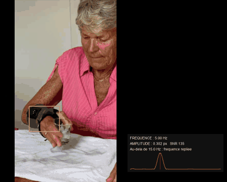
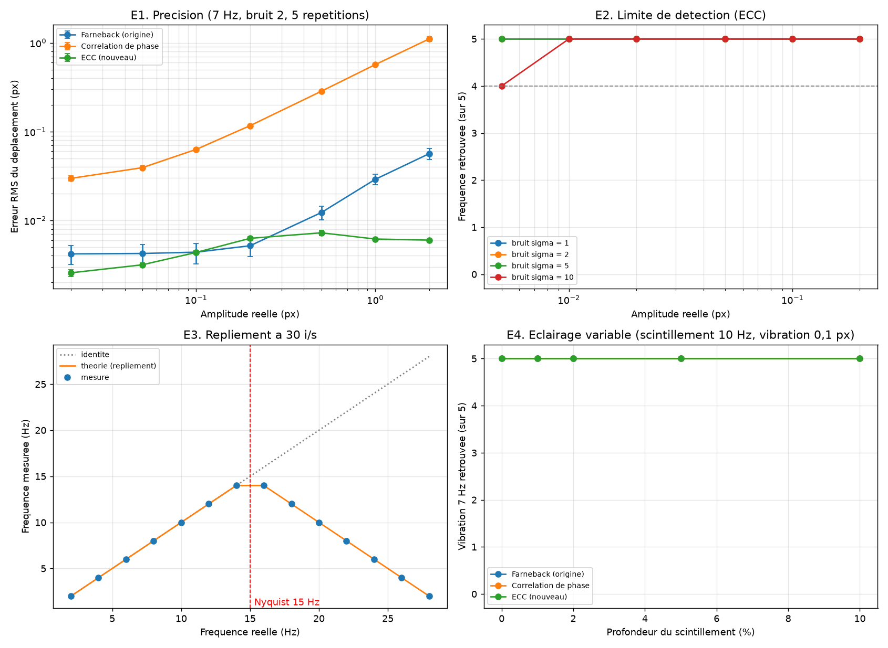

# Vibration Radar

Savoir, avec une simple caméra, si un objet vibre avant de le toucher.


## Pourquoi

L'idée vient d'une médecin atteinte d'urticaire vibratoire : le contact avec un objet qui vibre déclenche une réaction. Elle voulait pouvoir vérifier, sur place et sans matériel de labo, qu'un équipement ne vibre pas avant d'y toucher (par exemple à l'entrée d'un bloc). J'ai donc choisi une webcam ou un téléphone plutôt qu'un capteur à coller sur l'objet.

## Ce que fait l'outil

- **Carte de chaleur** : flux optique de Farnebäck entre deux images successives, pour voir en temps réel où ça bouge. C'est une vue d'ensemble, pas une mesure.
- **Mesure sur une zone** (touche `Z`) : on sélectionne une zone, l'outil suit son déplacement au sous-pixel (recalage ECC, en pleine résolution) et en tire, par FFT, la fréquence en Hz, l'amplitude en pixels et un indice de confiance (SNR).

La zone est déclarée « en vibration » si le pic du spectre est net (SNR ≥ 6), s'il ne colle pas au bas de la bande (sinon c'est une dérive) et si l'amplitude dépasse 0,02 px. Ce seuil vient d'une mesure sur un mur immobile, détaillée plus bas.



## Validation

J'ai d'abord testé la mesure sur des vidéos synthétiques, où je connais la vraie fréquence et la vraie amplitude : une texture déplacée de A·sin(2πft), avec du bruit capteur, 256 images à 30 fps et 5 répétitions par cas. Le script est `validation/run_study.py` et les résultats sont dans `validation/results/`.



**E1. Précision.** Erreur sur l'amplitude, à 7 Hz :

| Amplitude | Farnebäck (réglages d'origine, flux moyen de la zone) | ECC |
|---|---|---|
| 0,02 px | 1,6 ± 1,0 % | 6,7 ± 0,9 % |
| 0,1 px | 1,4 ± 1,0 % | 5,2 ± 0,2 % |
| 0,5 px | 3,2 ± 0,6 % | 1,6 ± 0,1 % |
| 2 px | 4,0 ± 0,6 % | 0,2 ± 0,0 % |

Les deux méthodes retrouvent toujours la bonne fréquence. Ce résultat m'a surpris : Farnebäck est très précis, et c'est même le meilleur sous 0,2 px. Si la première version ne voyait pas les micro-vibrations, ce n'était donc pas à cause de l'algorithme, mais de la façon dont je l'utilisais pour l'affichage :
- image réduite à 320 px ;
- comparaison de deux images successives ;
- seuil à 4 px ;
- couleurs renormalisées à chaque image.

La corrélation de phase donne des résultats incohérents (environ −80 % sur l'amplitude avec scikit-image, des sauts aberrants avec `cv2.phaseCorrelate`). Je pense que le problème vient de ma mise en œuvre, donc je ne l'interprète pas.

**E2. Limite de détection.** La fréquence est retrouvée jusqu'à 0,005 px, même avec du bruit. C'est trop beau : mon bruit synthétique se moyenne sur toute la zone. Sur une vraie caméra, la limite viendra plutôt de la compression, de l'obturateur et du support.

**E3. Nyquist.** À 30 fps, une vibration au-dessus de 15 Hz est vue à une fausse fréquence (20 Hz → 10 Hz, 28 Hz → 2 Hz), exactement comme prévu. Pour savoir si ça vibre, ce n'est pas gênant. Pour connaître la fréquence, si.

**E4. Éclairage.** J'ai ajouté un scintillement de 10 Hz, plus fort d'un côté de l'image, jusqu'à 10 %. Aucune méthode ne se fait piéger. Mon scénario n'était sans doute pas assez dur : il reste à tester des ombres et des reflets.

**Vidéo plus réaliste.** `validation/demo_video.py` reprend une vraie image de `test_vibration.mp4` : seule la main tremble, à 5 Hz et 0,3 px, et la vidéo est compressée en mp4.
- Sur la main, l'outil mesure 5,00 Hz et 0,305 px.
- Sur le mur, la première version du critère annonçait une vibration : une dérive de 0,009 px vers 0,5 Hz, due à la compression. C'est ce qui m'a fait ajouter le seuil d'amplitude (le double de cette dérive) et le test du bas de bande. Depuis, le mur est bien déclaré immobile.

`test_vibration.mp4` ne peut pas servir à valider la fréquence : ce sont des plans de 1 à 1,5 s, avec de grands mouvements de main, et on ne connaît pas la vraie valeur. Elle reste utile pour la carte de chaleur.

## Limites

- **Aucune mesure sur une vraie vibration pour l'instant.** La prochaine étape : filmer une source de fréquence connue (haut-parleur et générateur de fréquence, sous 15 Hz) et comparer avec un accéléromètre.
- **Fréquence max :** 15 Hz pour une webcam à 30 fps, 120 Hz pour un téléphone en ralenti à 240 fps. Le test médical de provocation utilise un vortex à 780–1380 tr/min, soit 13 à 23 Hz : c'est le ralenti qu'il faut.
- **Le risque principal est le faux négatif :** dire qu'un objet est immobile alors qu'il vibre. Par exemple si la vibration est trop petite, ou si elle se moyenne dans le temps de pose.
- **L'amplitude est en pixels :** pas de calibration en mm pour l'instant.
- **La caméra doit être fixe.** Il n'y a pas encore de correction avec une zone de référence.
- **En direct**, la carte de chaleur tourne à environ 17 fps en 1280×720 sur mon i5-12500H. L'outil utilise donc la cadence réelle de la webcam comme base de temps.
- **On ne connaît pas le seuil qui déclenche la réaction :** je n'ai trouvé aucune valeur publiée, et il faudrait des essais encadrés médicalement.

## Et ensuite

La partie FFT (`FrequencyAnalyzer.analyze`) marche telle quelle sur un signal d'accéléromètre. Seule la partie « déplacement par caméra » change. Un accéléromètre échantillonné à quelques kHz n'a plus la limite de 15 Hz et mesure ce que la peau reçoit vraiment.

## Utilisation

```bash
pip install -r requirements.txt
python main.py
```

| Touche | Action |
|---|---|
| `Z` | Choisir une zone à mesurer |
| `C` | Effacer la zone |
| `+` / `-` | Sensibilité de la carte de chaleur |
| `Échap` | Quitter |

Tests : `python -m unittest discover tests`


---

[richedor](https://github.com/Richedor), M2 TSI Image-Vision, Université Bourgogne Europe
